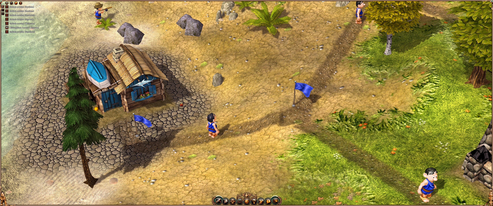
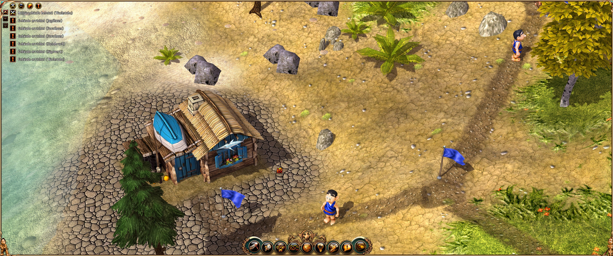

# Settlers II – 10th Anniversary: Community Pack

Graphics and interface upgrade for *Die Siedler II – Die nächste Generation* / *The Settlers II – 10th Anniversary*,
built on top of the [Community Patch](https://github.com/S2-modders/Settlers-DNG-Patches) by zocker_160 / S2-modders.
**No game files are included** – everything is generated from your own copy of the game.

## What's in it

| | Optimisation | Default |
|---|---|---|
| ⚙️ | **In-game settings menu** – F10 opens all Community Pack switches (graphics, effects, packs, interface, fixes) with explanations; changes are saved to `bin\d3d9.ini`, shader effects (FXAA, SSAO, DOF, bloom, terrain, water, object light, rim light) change live, the menu says which need a restart (`[UI] Menu`, `MenuKey`) | on |
| ⏩ | **Skip intro** – no logo videos and no intro film at startup, straight to the main menu (`[Misc] SkipIntro`) | off |
| 🖥️ | **HUD scaling** – interface, dialogs, fonts and minimap scaled for 1440p / 4K / ultrawide; mouse input matches automatically | `Scale = 1.5` |
| 🔍 | **HD interface** – all interface textures, menu logo and fonts upscaled 2× with Real-ESRGAN | on |
| 🌍 | **HD world textures** – 4K remakes from [S2-modders](https://github.com/S2-modders/Settlers-II-remakes-4k-textures-dds) | on |
| 🌗 | **Soft shadows** – 3×3 PCF filtering instead of jagged shadow edges (all shaders incl. terrain) | on |
| 🎯 | **Precise shadows** – 32-bit instead of 16-bit shadow/depth maps | on |
| 📐 | **Shadow resolution** – shadow map 4096² instead of 2048² (8192² optional) | `2` |
| 💧 | **Reflection resolution** – water reflection 4096×2048 instead of 2048×1024 | `2` |
| 🌲 | **View distance** – less LOD pop-in when zoomed out | on |
| ✨ | **Post-processing** – the game's bloom and depth of field, which normally need the launch parameter `-postFX` (GOG does not pass it), switched on by the DLL; Gaussian blur, adjustable depth-of-field haze (`DOFStrength`, default 0.3) | on |
| 🔬 | **Supersampling** – 3D scene and interface rendered at 2× the resolution and shrunk: smooth foliage, roof and polygon edges, finer textures; optional MSAA on top (`SupersamplingMSAA`); about 10 % fewer FPS at 3440×1440 on an RX 9070 XT | `off` |
| 🪚 | **FXAA** – edge smoothing in the post-processing pass (with post-processing the scene is rendered off-screen, where the patch's MSAA does not reach) | on |
| ⛰️ | **Terrain lighting** – Shader Model 3: sky/ground ambient light for more relief, fine detail layer at close zoom (`ImprovedTerrain`, `TerrainDetail`) | on |
| 🌊 | **Water** – Shader Model 3: Fresnel reflection, four wave layers, sharp sun glints, lighter water and a foam line at the shore (`ImprovedWater`) | on |
| 🏠 | **Object lighting** – houses, trees, rocks, settlers get the same sky/ground ambient light as the terrain (`ImprovedObjects`); soft rim light on settlers and animals so they stand out from the ground (`UnitRimLight`, default 0.5) | on |
| 🌑 | **SSAO** – ambient occlusion: contact shadows under trees, houses and in corners (the DLL binds the scene depth the engine never passed to this pass; transparent objects no longer write it) | on |
| ✨ | **Bloom** – soft glow around bright areas such as sunlit water and white walls; the original computed its brightness mask from the depth target and never used it (`[Graphics] Bloom` 0–1, `BloomThreshold`) | off |
| 🧠 | **4 GB memory** – large-address-aware flag on `S2DNG.exe` (2 GB → 4 GB address space; fewer out-of-memory crashes with HD content; stress-tested: the game runs with its memory above 2 GB; its shader compiler d3dx9_29, which cannot, gets reserved memory below 2 GB – `[Misc] LowHeap`) | on |
| 💾 | **Profile guard** – backs up your profile (settings + campaign progress) at every start and restores it automatically if it gets damaged (known bug: everything reset, only mission 1 left) | on |
| 🧹 | **Mesh cache guard** – clears the mesh/shader cache after a crash and disables it if its folder is not writable (known cause of crashes a few minutes into a map); `[Misc] MeshCache` | on |
| ⏱️ | **Clock fix** – the game's clocks count from game start instead of Windows start; animations and timers no longer get coarse with long PC uptime; `[Misc] TimeFix` | on |
| 🛟 | **Safe saving** – profiles and savegames are written to a temporary file and replace the old one only when complete; `[Misc] SafeSave` | on |
| 🌐 | **Multiplayer robustness** – fixes a network buffer overflow and unchecked values in game commands; `[Misc] GameFixes` | on |
| 🛠️ | **Crash diagnostics** – minidump + log on crashes (`DebugMode`) | off |

Every item can be switched individually in `bin\d3d9.ini` (`[Mods]`, `[UI]`, `[Graphics]`);
switched-off packs restore the original files on the next start.

## Fixes for the original game

Found by reverse engineering the original `S2DNG.exe` (GOG 11757) with [REA](https://github.com/morluto/rea) and Ghidra. Each patch checks the original bytes first and stays off on any other exe build.

| Bug in the original game | Effect | Fix |
|---|---|---|
| Clocks count from Windows start and are stored as 32-bit floats (`0x55D850`, `0x4474C0`) | animation/timer precision drops with PC uptime: 2 ms steps after 4.7 h, 64 ms after 10 days | `TimeFix` – clocks count from game start |
| Profiles and savegames are written in place (`CREATE_ALWAYS`, `0x448A90`) | a crash or power loss while saving leaves an empty file – settings and campaign progress lost ([report](https://gog.com/forum/the_settlers_series/settlers_ii_10th_anniversary_resets_all_progress_and_settings)) | `SafeSave` – temp file + atomic replace; `Profile guard` repairs files damaged earlier |
| Network buffer append ignores a failed `realloc` (`0x412C50`) | received data overwrites the heap | `GameFixes` – data dropped instead |
| Game command `0x2002F` writes with an unchecked index (`0x610390`) | a damaged command can overwrite memory outside a building | `GameFixes` – only valid indices (0–4) |
| Game command `0x20022` uses an unchecked index (`0x60F6F0`) | access outside a 6-entry table | `GameFixes` – invalid commands ignored |
| The player lookup of 21 command types has no range check (`0x454200`); a sender that no longer exists yields player -1 | access before the player table | `GameFixes` – such commands are skipped |
| Header texts of savegames and maps are read with an unchecked length into a 2 KB stack buffer (`0x448B10`) | a damaged or crafted map/savegame overwrites the stack | `GameFixes` – length limited to the buffer |
| The stream reader's size check can overflow, string lengths are not checked against the remaining data (`0x412CD0`, `0x412D80`) | damaged savegames, maps or network data read past the buffer | `GameFixes` – checks without overflow, lengths clamped |
| A damaged savegame/map throws a C++ exception nobody catches (`0x44A440`) | the game vanishes without a message | `GameFixes` – clear message, clean exit |
| The multiplayer file transfer (map download) uses the requested file name unchecked (`0x6E2868`) | any player in a game can download any file the host can read (`..\`, absolute paths) | `GameFixes` – names limited to the Documents folder |
| The shader compiler `d3dx9_29` fails with `E_OUTOFMEMORY` as soon as its memory lies above 2 GB | with the 4 GB flag the game can no longer build shaders once the lower 2 GB are used up | `LowHeap` – the compiler's allocations (malloc/new/HeapAlloc) go to address space reserved below 2 GB at start; when it is full, the normal allocator is used |
| On a damaged or wrongly packed encrypted game file (checksum/size mismatch) the game crashes on purpose by writing to address 0 (`NBase::gDecryptData`, `0x593C20`) | unexplained crash, e.g. with a broken mod file | `GameFixes` – message naming the file (mod or GOG file check), clean exit |
| Unencrypted Granny models (as mods ship them) are parsed by `granny2.dll` without any check | a damaged model writes past buffers and crashes | `GameFixes` – the header CRC is checked first; message naming the file |
| Loading a cube map (`0x51F1F0`, e.g. `data\enviroment\cube_0.dds`) is not checked, the texture is used later without a check too | a damaged or unsupported file (e.g. from a mod) or too little memory crashes when a map loads | `GameFixes` – a small neutral replacement texture is used, the map loads |
| Post-processing (bloom, depth of field) only runs with the launch parameter `-postFX` (`0x405D9A`), which neither GOG nor the shortcuts pass | the game's own post effects – and every shader effect built on them – never run | `PostFX` – the DLL sets the flag itself |
| Compiled shaders are cached by file name (`%LOCALAPPDATA%\S2`) | changed shader settings have no effect until the cache is cleared | the effects read their settings from live shader constants (`community_live.inc`), so no recompile is needed; the DLL clears the cache once when the shader interface changes |
| Direct3D distance fog is switched on for all objects (`0x50C1A0`), tuned for the original zoom | with the extended zoom every tree, house and rock turns pale blue when zoomed far out | `DistanceFog = off` – the DLL blocks the fog state |
| Mesh cache can be damaged or unwritable | crash a few minutes into a map ([report](https://gog.com/forum/the_settlers_series/settlers_ii_10th_anniversary_crashes_3/page1)) | `Mesh cache guard` |

Tested in single player sessions and a short LAN session (2 PCs, same version, including a disconnect): no false triggers, no desync. The error cases of the multiplayer fixes themselves could not be reproduced on purpose. In multiplayer all players should use the same version. The loading fixes were tested with deliberately damaged savegames (huge string length, truncated file, random bytes) and a damaged cube map; with the file transfer check active, a real map download in a LAN game (2 PCs) worked and the map was played. Note: the game only offers downloads of maps in `Documents\S2\maps`, not of maps in the game folder.
## Showcase

Same savegame, 3440×1440. Click an image for full resolution.

**Community Patch 2.3 only**



**With the Community Pack** – scaled and upscaled HUD and fonts, 4K textures, soft shadows, FXAA, SSAO


## Install (players)

1. Game: **GOG version** (build 11757) – retail/Gold edition updated to patch 11757 works for the data packs.
2. Install the **[Community Patch 2.3](https://github.com/S2-modders/Settlers-DNG-Patches/releases)** and start the game once.
3. Download `S2DNG-CommunityPack-<version>.zip` from [Releases](../../releases), extract the `CommunityPack` folder into the game folder (next to `bin` and `data`).
4. Run `CommunityPack\install.cmd` and start the game.

Uninstall: `CommunityPack\uninstall.cmd` (also restores the original `S2DNG.exe`). Full user guide (Deutsch / English): [community-pack/README.md](community-pack/README.md).

## Build it yourself

You need (all free):

| Tool | Used for | Link |
|---|---|---|
| Visual Studio 2022 (or Build Tools) with **"Desktop development with C++"** – includes CMake and the Windows SDK | patch DLL (`d3d9.dll`, Win32) | [visualstudio.microsoft.com](https://visualstudio.microsoft.com/downloads/) |
| Rust (`rustup`, MSVC toolchain) | decrypter used by the installer | [rustup.rs](https://rustup.rs/) |
| Git | cloning | [git-scm.com](https://git-scm.com/download/win) |
| PowerShell 5.1+ | build/installer scripts (part of Windows) | – |

```powershell
git clone https://github.com/gitlgn/Settlers2-10th-CommunityPack.git
git clone https://github.com/S2-modders/S2-10th-Anniversary-decrypter.git
cd Settlers2-10th-CommunityPack\community-pack
.\build-release.ps1 -Decrypter ..\..\S2-10th-Anniversary-decrypter -Version 1.0
```

Result: `dist\S2DNG-CommunityPack-1.0.zip` (patch DLL, installer scripts, decrypter).
Only the DLL: `cmake -S source -B build -A Win32` and `cmake --build build --config Release` from a *x86 Native Tools* prompt.

The installer (`install.ps1`) then builds the data packs on the player's PC from their own game files:
it decrypts the needed shaders/settings, patches them, and optionally downloads
[4K textures](https://github.com/S2-modders/Settlers-II-remakes-4k-textures-dds),
[Real-ESRGAN ncnn-vulkan](https://github.com/xinntao/Real-ESRGAN/releases/tag/v0.2.5.0) and
[texconv](https://github.com/microsoft/DirectXTex/releases) for the interface upscale.

### Source overview

| File | Purpose |
|---|---|
| `source/UIScale.*`, `uiscale_vs.hlsl` | HUD scaling (virtual HUD size, vertex shader for pre-transformed vertices), HD interface texture handling |
| `source/GfxPatches.*` | shadow map / reflection render target size patches |
| `source/ModSync.*` | switchable data packs under `<game>\mods` with automatic backup/restore |
| `source/GameGuard.*` | profile backup/restore (`Documents\S2\users\backup`), mesh/shader cache guard (`%LOCALAPPDATA%\S2`) |
| `source/TimeFix.*`, `source/SafeSave.*`, `source/BinaryFixes.*` | fixes for the original game (clocks, atomic saving, byte patches + command dispatcher check) |
| `source/NetTrace.*` | multiplayer diagnostics (`DebugMode`): received messages, executed commands, mouse clicks → `bin\nettrace.log` |
| `source/Overlay.*`, `source/third_party/imgui` | in-game settings menu (Dear ImGui; own fixed-function renderer and texture upload – the stock DX9 backend draws nothing / deadlocks under this game + DXVK) |
| `source/Profiler.*` | `DebugMode` sampling profiler of the render thread (`bin\profile.trigger`) |
| `source/SceneSS.*` | supersampling (own 2× render target in place of the back buffer), one-frame D3D9 trace for `DebugMode` |
| `source/LowHeap.*` | keeps the memory of the game's D3DX below 2 GB (4 GB flag) |
| `source/FixDecisions.*`, `source/tests/` | decision logic of the binary fixes + headless tests (`cmake --build build --target FixTests`) |
| `source/LAAStress.*` | test for the 4 GB flag (`[Misc] LAAStressTest`): blocks the address space below 2 GB during a game |
| `source/CrashDiag.*` | crash handler (minidump, log) for `DebugMode` |
| `source/GfxPatches.*` (`community_live.inc`) + `community-pack/shaders/community_postfx.inc` | FXAA and SSAO in the post-processing combine pass, live shader settings, depth target bound for the combine pass |
| `community-pack/shaders/community_terrain.inc`, `community_water.inc`, `community_objects.inc` | improved terrain and water lighting (included by the patched shaders) |
| `community-pack/` | installer, uninstaller, ini template, release script, user README |

## Related community projects

- [S2-modders/Settlers-DNG-Patches](https://github.com/S2-modders/Settlers-DNG-Patches) – Community Patch (widescreen, zoom, Vulkan, lobby) – **required**
- [S2-modders/Settlers-DNG-lobby-emulator](https://github.com/S2-modders/Settlers-DNG-lobby-emulator) – own lobby server for online play
- [S2-modders/S2-10th-Anniversary-decrypter](https://github.com/S2-modders/S2-10th-Anniversary-decrypter) – decrypt/encrypt game files
- [S2-modders/s2-map-format](https://github.com/S2-modders/s2-map-format) – map format documentation
- [S2-modders/Settlers-II-remakes-4k-textures](https://github.com/S2-modders/Settlers-II-remakes-4k-textures) – 4K texture sources

## Credits & licence

Fork of [Settlers-DNG-Patches](https://github.com/S2-modders/Settlers-DNG-Patches) by **zocker_160** / S2-modders, licensed under **GPL-3.0** ([LICENSE](LICENSE));
the original project documentation is in [README.upstream.md](README.upstream.md).
Third-party components: [community-pack/THIRD-PARTY.md](community-pack/THIRD-PARTY.md).

*The Settlers*, *Die Siedler* and *Blue Byte* are trademarks of Ubisoft Entertainment.
This is an unofficial fan project, not affiliated with Ubisoft, Blue Byte or Funatics. You need your own copy of the game.
