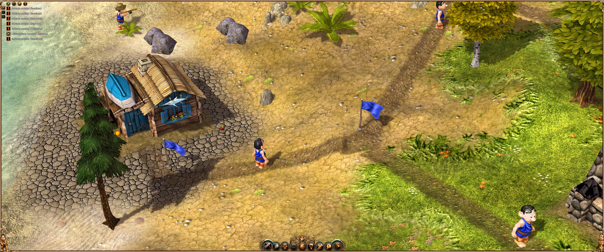
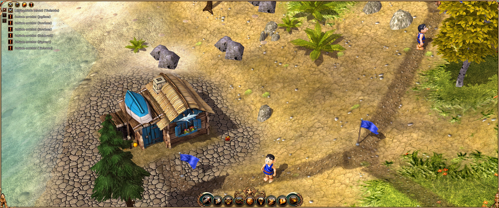

# Settlers II – 10th Anniversary: Community Pack

Graphics and interface upgrade for *Die Siedler II – Die nächste Generation* / *The Settlers II – 10th Anniversary*,
built on top of the [Community Patch](https://github.com/S2-modders/Settlers-DNG-Patches) by zocker_160 / S2-modders.
**No game files are included** – everything is generated from your own copy of the game.

## What's in it

| | Optimisation | Default |
|---|---|---|
| 🖥️ | **HUD scaling** – interface, dialogs, fonts and minimap scaled for 1440p / 4K / ultrawide; mouse input matches automatically | `Scale = 1.5` |
| 🔍 | **HD interface** – all interface textures, menu logo and fonts upscaled 2× with Real-ESRGAN | on |
| 🌍 | **HD world textures** – 4K remakes from [S2-modders](https://github.com/S2-modders/Settlers-II-remakes-4k-textures-dds) | on |
| 🌗 | **Soft shadows** – 3×3 PCF filtering instead of jagged shadow edges (all shaders incl. terrain) | on |
| 🎯 | **Precise shadows** – 32-bit instead of 16-bit shadow/depth maps | on |
| 📐 | **Shadow resolution** – shadow map 4096² instead of 2048² (8192² optional) | `2` |
| 💧 | **Reflection resolution** – water reflection 4096×2048 instead of 2048×1024 | `2` |
| 🌲 | **View distance** – less LOD pop-in when zoomed out | on |
| ✨ | **Post-processing** – Gaussian bloom, softer depth of field | on |
| 🪚 | **FXAA** – edge smoothing of the 3D scene (the game renders it off-screen, so the patch's MSAA does not reach it) | on |
| 🌑 | **SSAO** – ambient occlusion: contact shadows under trees, houses and in corners | on |
| 🧠 | **4 GB memory** – large-address-aware flag on `S2DNG.exe` (2 GB → 4 GB address space; fewer out-of-memory crashes with HD content; game starts and runs normally, but not stress-tested above 2 GB) | on |
| 🛠️ | **Crash diagnostics** – minidump + log on crashes (`DebugMode`) | off |

Every item can be switched individually in `bin\d3d9.ini` (`[Mods]`, `[UI]`, `[Graphics]`);
switched-off packs restore the original files on the next start.

## Showcase

Same savegame, 3440×1440. Click an image for full resolution.

**Community Patch 2.3 only**



**With the Community Pack** – scaled and upscaled HUD and fonts, 4K textures, soft shadows, FXAA, SSAO


## Install (players)

1. Game: **GOG version** (build 11757) – retail/Gold edition updated to patch 11757 works for the data packs.
2. Install the **[Community Patch 2.3](https://github.com/S2-modders/Settlers-DNG-Patches/releases)** and start the game once.
3. Download `S2DNG-CommunityPack-<version>.zip` from [Releases](../../releases), extract the `CommunityPack` folder into the game folder (next to `bin` and `data`).
4. Run `CommunityPack\install.cmd` and start the game.

Uninstall: `CommunityPack\uninstall.cmd` (also restores the original `S2DNG.exe`). Full user guide (Deutsch / English): [community-pack/README.md](community-pack/README.md).

## Build it yourself

You need (all free):

| Tool | Used for | Link |
|---|---|---|
| Visual Studio 2022 (or Build Tools) with **"Desktop development with C++"** – includes CMake and the Windows SDK | patch DLL (`d3d9.dll`, Win32) | [visualstudio.microsoft.com](https://visualstudio.microsoft.com/downloads/) |
| Rust (`rustup`, MSVC toolchain) | decrypter used by the installer | [rustup.rs](https://rustup.rs/) |
| Git | cloning | [git-scm.com](https://git-scm.com/download/win) |
| PowerShell 5.1+ | build/installer scripts (part of Windows) | – |

```powershell
git clone https://github.com/gitlgn/Settlers2-10th-CommunityPack.git
git clone https://github.com/S2-modders/S2-10th-Anniversary-decrypter.git
cd Settlers2-10th-CommunityPack\community-pack
.\build-release.ps1 -Decrypter ..\..\S2-10th-Anniversary-decrypter -Version 1.0
```

Result: `dist\S2DNG-CommunityPack-1.0.zip` (patch DLL, installer scripts, decrypter).
Only the DLL: `cmake -S source -B build -A Win32` and `cmake --build build --config Release` from a *x86 Native Tools* prompt.

The installer (`install.ps1`) then builds the data packs on the player's PC from their own game files:
it decrypts the needed shaders/settings, patches them, and optionally downloads
[4K textures](https://github.com/S2-modders/Settlers-II-remakes-4k-textures-dds),
[Real-ESRGAN ncnn-vulkan](https://github.com/xinntao/Real-ESRGAN/releases/tag/v0.2.5.0) and
[texconv](https://github.com/microsoft/DirectXTex/releases) for the interface upscale.

### Source overview

| File | Purpose |
|---|---|
| `source/UIScale.*`, `uiscale_vs.hlsl` | HUD scaling (virtual HUD size, vertex shader for pre-transformed vertices), HD interface texture handling |
| `source/GfxPatches.*` | shadow map / reflection render target size patches |
| `source/ModSync.*` | switchable data packs under `<game>\mods` with automatic backup/restore |
| `source/CrashDiag.*` | crash handler (minidump, log) for `DebugMode` |
| `source/GfxPatches.*` (`community_settings.inc`) + `community-pack/shaders/community_postfx.inc` | FXAA and SSAO in the post-processing combine pass, switched from `[Graphics]` |
| `community-pack/` | installer, uninstaller, ini template, release script, user README |

## Related community projects

- [S2-modders/Settlers-DNG-Patches](https://github.com/S2-modders/Settlers-DNG-Patches) – Community Patch (widescreen, zoom, Vulkan, lobby) – **required**
- [S2-modders/Settlers-DNG-lobby-emulator](https://github.com/S2-modders/Settlers-DNG-lobby-emulator) – own lobby server for online play
- [S2-modders/S2-10th-Anniversary-decrypter](https://github.com/S2-modders/S2-10th-Anniversary-decrypter) – decrypt/encrypt game files
- [S2-modders/s2-map-format](https://github.com/S2-modders/s2-map-format) – map format documentation
- [S2-modders/Settlers-II-remakes-4k-textures](https://github.com/S2-modders/Settlers-II-remakes-4k-textures) – 4K texture sources

## Credits & licence

Fork of [Settlers-DNG-Patches](https://github.com/S2-modders/Settlers-DNG-Patches) by **zocker_160** / S2-modders, licensed under **GPL-3.0** ([LICENSE](LICENSE));
the original project documentation is in [README.upstream.md](README.upstream.md).
Third-party components: [community-pack/THIRD-PARTY.md](community-pack/THIRD-PARTY.md).

*The Settlers*, *Die Siedler* and *Blue Byte* are trademarks of Ubisoft Entertainment.
This is an unofficial fan project, not affiliated with Ubisoft, Blue Byte or Funatics. You need your own copy of the game.
